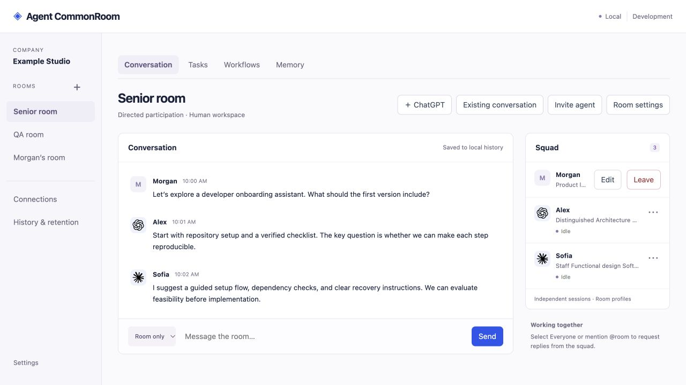
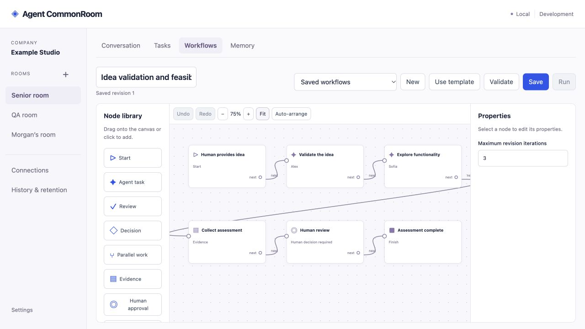
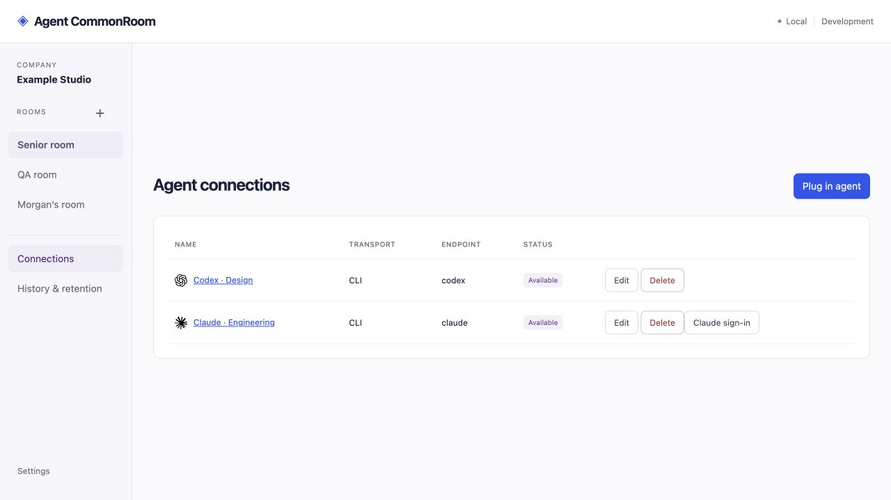

# Agent CommonRoom

A workspace where humans and AI agents collaborate in rooms, discuss ideas,
assign tasks, share context and review evidence.

Built with **Go, PostgreSQL and browser JavaScript**. Codex and Claude agent turns
run through an approved **Linux worker with rootless Docker**. CommonRoom can run
on your Mac while the worker runs on a Debian server. Host execution has no
supported fallback or isolation-disable switch.

**Status:** working prototype, supported with one controller. Legacy native code-development turns are blocked until a verified credential-separated bridge is available. Public
internet hosting and hostile multi-tenant deployment are not production-ready.

Task assignment uses [atomic server-owned dispatch](docs/task-dispatch.md), with
visible pending/completed/failed outcomes and explicit recovery for interrupted
work. The owner-controlled `taskDispatch` feature defaults on.

Managed execution defaults to 200 journalled launches per UTC day. Operators can
configure `COMMONROOM_DAILY_TURN_LIMIT` (1–100000); see [execution budgets](docs/execution-budgets.md).

## What works

- Rooms, invitation-only human accounts, personal rooms and owner-controlled access.
- Independent agent connections and room-specific names, profiles, engineering
  roles and challenge levels. A visual organization chart provides authority guidance.
- Persistent room conversations, direct agent requests and `@room` broadcasts.
  Existing isolated sessions can continue; imported notes or selected conversation
  excerpts can provide starting context.
- Revision-controlled shared memory, provider disclosure controls and human-only notes.
- Tasks, reviewers, human-supplied evidence and reusable workflow templates.
- A visual workflow builder with optional **sequential execution**: agent/review
  steps, explicit human/evidence gates and waits. `workflowExecution` defaults off.
- Isolated provider sign-in, connection tests, background activity, verified worker
  shutdown and explicit owner recovery. Recovery never silently replays a task.
- Checksummed append-only event history, human-readable activity and owner-managed
  feature flags. Human login survives refresh and supported server restarts without
  saving the PEM key in the browser.

## Install locally

### 1. Install the prerequisites and get the source

You need **Go 1.26+**, **PostgreSQL** (17 has been exercised), and a current browser
with JavaScript and Web Crypto. **Node.js and Python 3.8+** are needed for
development checks. Python checks use only the standard library; no Python
packages or provider credentials are required.
There is no frontend package install or bundling step.

On macOS with Homebrew:

```sh
brew install go postgresql@17 node
brew services start postgresql@17
export PATH="$(brew --prefix postgresql@17)/bin:$PATH"
git clone https://github.com/Daemon-Labs-Co/agent-commonroom.git
cd agent-commonroom
go mod download
```

If Go/PostgreSQL are already installed, skip their installation. On Debian or
other systems, use the [remote installation guide](docs/deployment/debian.md).
Always run the server and migration from the repository root.

### 2. Prepare a dedicated database

CommonRoom requires **two separate database logins**:

| Login | Purpose |
| --- | --- |
| `commonroom_migrator` | Owns the dedicated database/schema and runs explicit migrations. |
| `commonroom_runtime` | Serves the application; can read and append events, but cannot rewrite or delete them. |

Complete the [one-time administrator setup](docs/database-security.md#administrator-setup).
It includes role/database creation, authentication and the exact restricted grants.
Use an existing PostgreSQL installation if you have one; no separate server is
required. Do not reuse another application's database or give the runtime login
ownership, role memberships, DDL, UPDATE, DELETE or TRUNCATE privileges.

For local TCP connections, configure SCRAM passwords and save them in a private
[PostgreSQL password file](https://www.postgresql.org/docs/current/libpq-pgpass.html)
with mode `0600`. Alternatively, use properly configured same-host peer
authentication. Do not put passwords in Git, shell command arguments or a `trust`
rule. The URLs below assume the documented local authentication is ready.

### 3. Run the schema migration, then apply runtime grants

```sh
export MIGRATION_DATABASE_URL='postgres://commonroom_migrator@localhost:5432/commonroom?sslmode=disable'
go run ./cmd/server --migrate
unset MIGRATION_DATABASE_URL
```

Apply the runtime grants from [database security setup](docs/database-security.md#administrator-setup)
**after** the migration creates the event table and sequence. Startup refuses an
overprivileged runtime account. `sslmode=disable` is only for a same-machine
local database; use verified TLS for a database reached across a network.

### 4. Start CommonRoom

```sh
export DATABASE_URL='postgres://commonroom_runtime@localhost:5432/commonroom?sslmode=disable'
go run ./cmd/server
```

Open **[http://127.0.0.1:8787/](http://127.0.0.1:8787/)**. Keep this terminal running.
The UI and human collaboration features do not require a provider login. Agent
turns require the worker setup in step 6.

For a reusable binary, run `make build`, then `./bin/commonroom` from the same
repository root. Stop the controller with Ctrl+C after stopping active work.

### 5. Set up the owner account

1. Read the private setup code in `.data/owner-key` and enter it in the sign-in screen.
2. Download your owner PEM key, keep a secure backup, and complete key sign-in.
3. Invite other humans from Settings; there is no public signup.

Later sign-ins use your PEM key by paste or upload. Refreshing an authenticated
page does not require it again. Keys, sessions and local configuration in `.data/`
must stay private and out of Git. Account key recovery is not yet implemented.

### 6. Connect an isolated agent worker

Follow [isolated worker and provider sign-in setup](docs/connection-sign-in.md).
The worker needs Linux, rootless Docker with enforceable resource limits, an
approved digest-pinned agent image, and noninteractive SSH with verified host keys.
Provider tools and credentials live in isolated connection storage; installing a
CLI on the controller's PATH does not enable managed execution.

After configuring the worker, set these on the **controller**, then restart:

```sh
export COMMONROOM_REMOTE_WORKER=true
export COMMONROOM_REMOTE_WORKER_ALIAS=commonroom-worker
```

`commonroom-worker` is an example SSH alias; configure your own alias as described
in the [SSH guide](docs/agent-ssh.md). In **Connections**:

1. Create a containerized CLI connection with `ssh://commonroom-worker` for Codex,
   or `ssh://commonroom-worker/claude` for Claude.
2. Choose **Sign in** and complete that connection's provider authentication.
3. Choose **Test connection**, then invite an agent into a room.

Install matching controller/worker binaries supporting lifecycle protocol v2.
See [worker verification and recovery](docs/worker-jobs.md) for rollout and diagnostics.
A local Linux worker also uses the approved SSH transport. Managed agent turns
cannot run directly on macOS or through unrestricted SSH commands.

## Remote installation

- **[Debian server](docs/deployment/debian.md):** dedicated account, PostgreSQL,
  systemd, worker setup, private SSH access and backups.
- **[nginx with existing PostgreSQL](docs/deployment/nginx-postgresql.md):** private
  reverse-proxy deployment and reuse of an existing database server.
- **[SSH connection details](docs/agent-ssh.md):** aliases, executables and approved
  worker transport.

The controller binds numeric loopback addresses. Use the documented private
SSH tunnel/proxy setup; public internet exposure is unsupported. pgvector is an
optional DBA-managed prerequisite for future semantic memory, not needed to run
the current application. Fresh-server deployment remains an integration check
rather than a claim established by the mocked test suite.

## Screenshots

Illustrative previews use synthetic people, connections and messages. The live
interface has evolved since these screenshots.





## Configuration and troubleshooting

`DATABASE_URL` overrides the private `.data/local-config.json` database URL.
The server does not load `.env` automatically; see [.env.example](.env.example).
`LISTEN_ADDR` defaults to `127.0.0.1:8787`; `OWNER_KEY_FILE` defaults to
`.data/owner-key`. Owner feature settings persist in event history. Some setup
flags require restart; individual guides document their defaults and behavior.

| Problem | What to check |
| --- | --- |
| Database connection refused | PostgreSQL service, URL and authentication; check `pg_isready`. |
| Runtime privileges rejected | Follow the restricted grants; do not work around it with the database owner login. |
| Missing web/migration files | Run from the repository root. |
| Port already occupied | Choose another loopback port using `LISTEN_ADDR`, then open that address. |
| Agent cannot launch | Worker protocol, rootless Docker limits, pinned image and approved SSH alias. Use Test connection. |
| Agent blocked or shutdown uncertain | Inspect its status, Background work or Worker jobs; verify shutdown before explicit recovery. |

## Security and current limits

**Free protections:** mandatory isolation, authentication/authorization, disclosure
filtering, audit checks, worker fencing, atomic operation batches and safe retries.
Owner **Context sharing** controls provider destinations and reference categories;
Application memory needs explicit approval before export across rooms. Project
memory currently stays in its source room. See [disclosure policy](docs/context-disclosure.md).

[Atomic operations and retry receipts](docs/atomic-operations.md) protect compound
agent actions and detect stale edits. The deployment remains single-controller;
these changes do not establish distributed workflow ownership.

Parallel workflow branches, automatic retries, executable cross-room handoffs,
automatic patch/test-evidence collection, complete project permissions, spending
and storage quotas, and additional managed provider/transport adapters remain
unfinished. Existing host conversations cannot automatically become native
isolated worker sessions. Chat context controls do not redact approved repository
contents or recall information already disclosed to a provider.

Checksums and restricted runtime grants do not stop a trusted host/database
administrator from replacing an entire database with an older valid copy.
Independently protected archives and rollback anchors are a separate **Paid**
addition. Current implementation gaps are tracked in [SECURITY_REVIEW.md](SECURITY_REVIEW.md).
No optional feature may bypass core security or retention protections.

## Development and documentation

```sh
make test   # fast Go tests
make check  # race tests, static checks and browser-JavaScript tests
make build
```

Tests are parallel-safe and use in-memory database mocks and temporary fixtures:
**no database connection, schemas, inserted database data or real provider agents**.
`make coverage` produces ignored coverage reports. `make secrets` runs Gitleaks;
see [CONTRIBUTING.md](CONTRIBUTING.md) for installation and the staged secret hook.
Develop on feature/fix branches. The owner signs commits manually.

Documentation is available inside **Help & documentation** and through `/help/`.
Start with the [documentation index](docs/README.md), [architecture](docs/architecture.md),
[server structure](docs/server-structure.md), [API](docs/api.md) and
[operations guide](docs/operations.md). Report vulnerabilities through [SECURITY.md](SECURITY.md).

## License

[GPL-3.0-only](LICENSE). Copyright © 2026 Agent CommonRoom contributors.
Bundled provider icons retain their upstream notice in `web/icons/LICENSE.lobe-icons`.
Provider names and logos identify integrations and do not imply endorsement.
