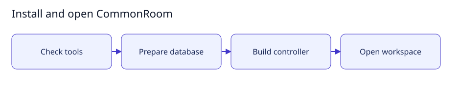

# Deploy CommonRoom as an ordinary user



This is a setup illustration, not proof of a live deployment. Templates here are
versioned; passwords, generated SQL containing passwords and site configuration
belong outside Git. No helper installs packages or invokes sudo. Existing database,
DNS and HTTPS administrators configure their services through their normal access.

1. Build with `bash scripts/setup.sh --build`. Run the existing migration with the
   migration-owner login; see [database setup](../docs/technical/archive/database-security.md).
2. If no runtime login exists, ask the database administrator to run the role
   template and set its password with psql's interactive `\password` command.
   Administrators can use their own login; becoming an OS superuser is not required.
3. Apply grants **to the migrated application database**, using its actual port:

   ```bash
   psql -p 5432 -d commonroom -U your_database_administrator -v runtime_role=commonroom_runtime -f deployment/postgres/create-runtime-role.sql
   psql -p 5432 -d commonroom -U your_database_administrator -v database=commonroom -v runtime_role=commonroom_runtime -f deployment/postgres/runtime-grants.sql
   ```

   Existing runtime roles skip creation. `GRANT CONNECT` never switches databases.
   The grant template refuses a database-name mismatch and stops on errors.
4. Prepare private configuration and edit its URL, hostname and service paths:

   ```bash
   install -d -m 700 ~/.config/commonroom ~/.config/systemd/user
   install -m 600 deployment/runtime.env.example ~/.config/commonroom/runtime.env
   cp deployment/commonroom.service ~/.config/systemd/user/commonroom.service
   ```

   Configure exactly `COMMONROOM_PUBLIC_ORIGIN=https://agentcommonroom.home.arpa`
   for this hostname. Leave it unset for local-only browser access. It is read on
   restart and can be changed only by the operator controlling service configuration.
5. Point DNS at the server, configure the existing HTTPS proxy using
   [the nginx template](nginx/commonroom.conf), and install a browser-trusted
   certificate for that name. Keep the application listener on loopback. Forward
   the original Host and Origin; never rewrite an untrusted origin to localhost.
6. Start the user service:

   ```bash
   systemctl --user daemon-reload
   systemctl --user enable --now commonroom.service
   curl --fail https://agentcommonroom.home.arpa/ -o /dev/null
   ```

Expected result: the HTTPS origin serves the login UI; unconfigured hosts and
cross-site requests remain rejected. Public-origin sessions use Secure, HttpOnly,
SameSite=Strict cookies. Removing the origin setting restores local-only admission
on restart without deleting application history. User-service startup at boot
without a login depends on the server's existing user-manager policy. No coding
execution or publishing readiness is implied by a successful HTTP check.

For a worker on the application machine, copy `worker-config.json.example` to
`~/.config/commonroom-worker/config.json` with mode `600`. Replace `image` with
the immutable installed CommonRoom agent image ID and `authDir` with an absolute
private credential directory. Set `COMMONROOM_SERVER_WORKER=true` and
`COMMONROOM_REMOTE_WORKER=false` in the service environment, then restart.
The same-machine worker invokes the constrained `--agent-worker` entry point;
it does not require an SSH alias or permit direct host model execution.
