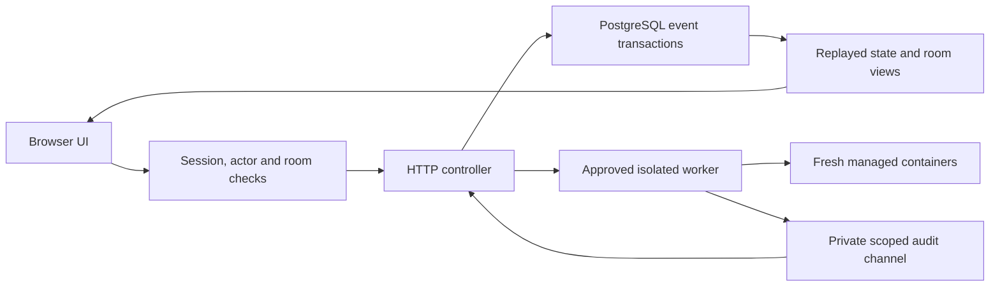

# Architecture

Agent CommonRoom is a Go HTTP controller, a PostgreSQL append-only event store,
a plain JavaScript browser UI and a mandatory Linux rootless-Docker execution
worker. The supported control plane is one controller; it is not a distributed
queue, public multi-tenant service or enterprise compliance claim.

## Runtime shape

The controller serves relative repository assets and runs from the repository
root. HTTP binds numeric loopback addresses; documented remote access uses an
SSH tunnel. A remote execution worker uses a separate approved SSH alias and
worker protocol. SSH transport alone never makes a provider process isolated.

## Startup and requests

Startup acquires the local controller lease, validates private configuration,
connects with the restricted runtime database role and restores safety state.
Database schema changes use the explicit `--migrate` entry point with separate
migration credentials; normal startup performs no DDL. The database URL comes
from the environment, private local configuration or the development default.
See [database setup](database-security.md) before changing roles or transport.

Requests pass host/origin, authenticated-session, actor/account and room checks.
Mutation handlers additionally enforce CSRF, payload budgets, permissions,
revisions and supported retry keys. Frontend controls only present authority;
server checks enforce it. Missing identity never implies owner authority.

## State, transactions and integrity

The `events` table stores sequence, ID, kind, JSON payload, commit timestamp,
previous hash and hash. `appendBatch` commits related events under a PostgreSQL
advisory transaction lock, canonicalizes JSON, stamps actor/protected metadata
and optionally writes an idempotency receipt in the same transaction. Supported
operations persist intent before dispatch; failures roll back the batch.

`load` replays retained history into `room.State`; room/actor projections filter
what the browser receives. Whole-state replay remains a scaling concern, despite
bounded waits and history paging. Supported mutable aggregates use revision
checks, while expected event counts conservatively reject stale operations.
[Atomic operations](atomic-operations.md) describe retry and conflict semantics.

The database trigger rejects ordinary mutation of events. New records protect
ID, sequence and time inside their hashed metadata; legacy metadata is not
retroactively protected. Integrity failure cancels contexts and latches execution
off. A privileged administrator can still rewrite or roll back a valid chain:
independent immutable storage and externally anchored heads remain required.
See [security hardening](security-hardening.md).

## Agent admission and lifecycle

The controller reserves process-local active/cancel slots for chat and workflows.
Mandatory logical limits are eight active turns overall and four per room;
broadcasts preflight the whole eligible batch. Durable physical container
reservations additionally cap accounts at four managed containers, counting a
pair as two and retaining uncertain jobs. Paid limits are not implicitly unlimited.
See [container quotas](container-quotas.md).

Worker version-2 chat jobs have durable intent and shutdown records. Version-4
development pairs bind both role identities and a fresh source workspace;
version-3 pairs are recovery-only. Creator leases, tombstone fencing and exact-ID
absence checks distinguish cancellation from confirmed shutdown. Existing used
containers/workspaces cannot be adopted or restarted. Failed/unknown cleanup
retains evidence and capacity. There is no automatic replay of ambiguous work.

Internal Codex development now connects audited session, source bootstrap,
engine/tool assembly, credential lease, private gateway, callback turn and fenced
cleanup. Public production admission remains blocked pending acceptance. See
[provider/tool separation](provider-tool-separation.md) and
[release readiness](release-readiness.md). A source-level internal method is not
an enabled provider feature.

## Mandatory container isolation design contract

**Decision:** container isolation is mandatory for managed agent development.
There is no Security toggle, per-connection exemption, environment switch or
automatic direct-execution fallback. If isolation cannot be established, refuse
new managed work. Importing external conversations supplies untrusted context;
it does not contain an externally launched process.

Managed `codexAdapter.Run` and `claudeAdapter.Run` use `isolatedAgentCommand`.
Supported execution requires the Linux rootless worker, locally or through the
approved remote-worker protocol. Host home, Docker socket, SSH agent and
application database/owner credentials must never reach agent containers.
Worker/host/kernel and reviewed image provenance remain trusted boundaries.
Containers do not prove resistance to every escape.

Development requires a credential-bearing engine separated from a credential-free
tool workspace, authenticated scoped broker calls and durable controller audit
acknowledgements. Legacy credential-bearing native development remains refused.
The tool role uses a fresh verified bundle and private volume; the engine gets
no repository/tool volume or native development-tool authority. See the
[separation contract](provider-tool-separation.md).

Human-authorized history import and provider sign-in are trusted administrative
capabilities. They cannot become alternate model-turn launch paths or expose
whole credential/history stores to agents. Current automated coverage is
synthetic; live image/provider/rootless acceptance remains incomplete.

### Source-level bypass warning

An open-source fork CAN replace the worker or adapter with direct host/SSH
execution, BUT doing so exposes accessible host files, credentials and network
authority to malicious repositories or model output. Stopping a launcher may
leave descendants or remote work running. Room permissions and application
monitoring cannot contain broader OS authority. Such a fork invalidates the
supported containment assumptions and must not be described as isolated.

Document this risk at adapter types, launch methods and command builders.
A source modification is not a supported configuration or exception.

### Development workspace admission

Development opt-in and controller/worker room/snapshot allowlists do not waive
security prerequisites. The current legacy-development barrier still refuses
execution. The separated implementation streams an approved bundle into the
credential-free tool volume, verifies digest/freshness/branch and bootstrap
receipt before the engine starts, and never mounts a writable host worktree.
Ordinary shutdown retains source; disposal needs its own explicit approval.

## Sequential workflows and evidence

`workflow_runner.go` validates/pins the definition, stores append-only run
revisions and drives one sequential step at a time using the same managed-turn
path as chat. It records intent before execution, releases the controller mutex
during provider work and rechecks policy, membership, cancellation and integrity
before saving outcomes. Failed result persistence prevents the next dispatch.

There is no automatic retry of ambiguous side effects. Owner-approved resume
can repeat partial effects and remains bounded by node visits. Restart exposes
interrupted runs rather than silently resurrecting work. This is not distributed
exactly-once execution, a general parallel swarm or paid consensus.

Provider output hashes identify reported text, not repository contents or
successful tests. Reviewer output is not independent filesystem evidence.
Bounded commands, revision-bound artifacts and trusted observed checks remain
unfinished. See [workflow execution](workflow-execution.md).

## Diagnostics and recovery

Background telemetry uses allowlisted stage labels, controller/job binding,
bounded polling and internal-only append events. Optional presentation flags
can hide it but cannot authorize work. Elapsed age is dispatch age, not progress
or a worker heartbeat. Failed polling means unknown liveness, not permission to
retry, extend deadlines or release reservations.

Owner recovery checks authentication, CSRF, room access, flags and safety state,
requires no local turns and freshly queries approved-worker `idle-v1`. Malformed,
nonterminal or unreadable journals fail closed; the bounded check does not delete
records, adopt jobs or resume workflow graphs. It runs under the controller lock
and can delay requests. It is not a distributed ownership lease.

## Source navigation

Use [server structure](server-structure.md) for controller responsibilities,
[worker jobs](worker-jobs.md) for lifecycle/recovery and
[security hardening](security-hardening.md) for required identity, database,
transport and deadline controls. The UI remains order-sensitive shared plain
JavaScript; a module split alone does not establish stronger trust boundaries.

The internal [byte custody foundation](object-custody.md) verifies bounded private inode bytes behind mandatory accounting and audit callbacks. It is not connected to dispatch or public export; real isolated-source, complete inventory, physical quota and journal adapters remain missing. File/bundle task delivery continues to refuse.

The internal [finite artifact manifest foundation](artifact-manifests.md) binds
exact declared members to verified sealed bytes and registered structural formats.
It is disconnected from managed/public delivery; actual source, quota and durable
journal adapters remain required and file/bundle dispatch continues to refuse.
