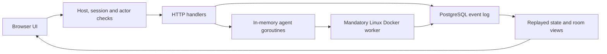

# Architecture

## Session recovery safety contract

`agentRecovery` validates owner identity, CSRF, room membership, the default-on
`agentRecovery` flag and audit/emergency controls. It requires no active controller
turns, then calls approved SSH `idle-v1`; the worker validates rootless Docker,
checks managed containers including stopped leftovers, and scans at most 4096
job-record directory entries. Nonterminal, malformed or unreadable records fail
closed. No cleanup or record deletion occurs. The controller mutex serializes
local dispatch/mutations throughout the bounded ten-second check; this can delay
other requests and is not a multi-controller lease.

Resume validates execution mode/workspace compatibility. Fresh resets only the
provider binding. A single append-only `agent.recovered` snapshot makes audit and
state transition atomic; presentation metadata is omitted from that snapshot.
Checks are never cached as permission for a later action. This conservative
whole-worker contract supports legacy failures without pretending their job IDs
were recorded. It does not reconcile orphaned jobs or resume workflow graphs.

## Background operational telemetry

`backgroundContext` attaches an internal context callback to managed chat/workflow
turns. The callback allows only fixed stage labels, binds membership/room/connection,
uses a controller turn ID, caps recording at 64 events and rejects post-completion
callbacks. Worker observations must match the controller-allocated job and provider;
polling uses the approved alias and existing `status-v1` protocol with a three-second
query deadline. No new inbound callback port or public agent credential is exposed.
Codex structured events produce only allowlisted command/tool start/end labels.

`agent.background` is internal append-only audit data. Replay substitutes trusted
labels, bounds room-scoped participant delivery, and omits telemetry with the
default-on `agentBackgroundWork` flag off. Public event ingestion cannot forge it.
Polling failures are observations of unknown liveness, never automatic cancellation,
retry or permission. Cleanup acknowledgements report confirmed/unconfirmed shutdown.
This does not implement durable leases, restart reconciliation, exhaustive tool
tracing, per-process resource statistics or progress-based timeout extensions.

## Model turn admission and age diagnostics

`openAgentDiagnosis` renders only the safe room-scoped status projection. Opening
it makes no network or model request. Owner-only status/test actions reuse
`provider-auth` and connection-testing authorization and flags; neither clears an
agent failure. Preparing a message performs no mutation or dispatch and preserves
the draft. The browser does not infer an expired credential from a killed process.

`server.agentAdmission` runs under the controller mutex against complete company
state before either chat or workflow reservation. It counts all active entries,
including removed participants awaiting cleanup, against an eight-turn global
bound, and known room memberships against a four-turn room bound. Broadcasts
preflight the full eligible batch before appending a message or starting turns.
Workflow overload records an explicit failed run and requires owner resume.
There is no durable queue, multi-controller coordination or spend accounting.
Mandatory limits cannot be disabled through product flags.

New `agent.activity` events include server-generated `startedAt`. Replay derives
elapsed seconds only for Working participants with a known timestamp. The
existing default-on `agentStatusDetails` flag gates both elapsed metadata and
warnings. `projectAgentElapsed` preserves integrity/emergency-stop explanations;
it makes no claim about worker heartbeat or meaningful progress. Context deadline
errors take precedence over killed-process exits in both adapters and completion
recording. Historical audit events are never rewritten.

[Documentation index](README.md)

## Runtime shape

Agent CommonRoom is a Go HTTP server with a PostgreSQL event store and a browser UI written in plain JavaScript. It is one process, not a microservice deployment. There is no frontend build system or durable background queue.

The server runs from the repository root because it loads migrations and serves web assets from relative paths. Listening is restricted to numeric loopback addresses. Debian access uses an SSH tunnel rather than public HTTP hosting.

## Startup and request flow

Startup selects DATABASE_URL, falling back to private local configuration and then the development default. It connects to PostgreSQL, applies migrations/001.sql, prepares owner authentication, registers handlers, and starts HTTP serving.

API requests pass through host/origin and session checks, then actor/account and room checks. Individual handlers validate methods, mutation tokens, and payloads. Authorization is server-side; frontend controls are only presentation. The current owner/member policy is described in the API overview and security review.

## State and events

PostgreSQL `events` contains sequence, ID, kind, JSON payload, commit timestamp, previous hash, and hash. append serializes writers with a PostgreSQL advisory transaction lock. load replays the log into room.State, after which visibility helpers filter room and actor views.

This is event-sourced state reconstruction without cached projections or general pagination. Reading state repeatedly replays history; this is a known scaling concern. Some business operations append multiple separate records and are not atomic as a whole. Memory, member, task, and workflow updates use revision checks where implemented; there is no universal concurrency or lease model.

The trigger rejects normal UPDATE/DELETE/TRUNCATE operations. Hashes currently cover previous hash, event kind, and PostgreSQL's payload text. They omit some metadata and have no independent rollback anchor. A privileged database administrator can bypass protections; absolute immutability is not achieved.

## Agent execution

A mutex protects process-local active/cancel maps and parts of mutation handling. Accepted agent work starts a goroutine with a three-minute context deadline. Each participant is limited to one active turn by the in-memory map. Provider session identifiers are saved through participant.session events.

Managed adapters invoke executables through a mandatory Linux rootless-Docker worker; prompts travel over stdin. Other platforms and direct SSH endpoints are blocked. Codex uses a read-only sandbox. Claude disables tools, MCP servers, and slash commands for the conversational trial. History browsing uses a separate Codex app-server RPC process.

Jobs do not survive application restart as durable work items. Process-group cleanup, remote cancellation, global resource limits, workspace confinement, and policy-controlled tool execution are incomplete. Application monitoring alone cannot reliably contain an unrestricted process.

## Source responsibilities

| Area | Responsibility |
| --- | --- |
| cmd/server/main.go | Startup, HTTP registration, events, replay, state, and integrity handlers. |
| cmd/server/auth.go and owner_rsa.go | Sessions, request checks, first-owner setup, challenges, signatures, and key download. |
| cmd/server/members.go | Human invitations, actor projection, permissions, personal rooms, and visibility. |
| cmd/server/agents.go and history.go | CLI turns, SSH commands, session continuation, and saved-history RPC. |
| cmd/server/provider_auth.go | Local Claude status and macOS login launch. |
| cmd/server/rooms.go and workflows.go | Room filtering, profile guidance, and graph validation. |
| internal/room/model.go | Domain structs and adapter capability declarations. |
| migrations/001.sql | Event-store schema and mutation-rejection trigger. |
| web/app.js | Base UI, connection/profile forms, API calls, messages, and sign-in. |
| web/features.js | Room navigation, tasks/evidence, profile extensions, provider icons, and member UI. |
| web/workflows.js | Visual graph editor, connections, properties, validation, and undo/redo. |
| web/provider-auth.js | Claude authentication dialog and connection-screen action. |
| cmd/server/documentation.go and web/help*.js/html/css | Allowlisted documentation serving, safe reader, and contextual overlays. |
| web/index.html and style.css | Page entry, script order, styling, and layout. |

Frontend scripts share global state and wrap existing functions. Script order matters. This structure is an acknowledged maintenance concern, not a prescribed long-term modular architecture.

## Intended evolution

The backlog calls for stronger authorization, a controlled execution gateway with OS/process isolation, durable jobs and workflow state, typed adapter transports, stronger event integrity, independent immutable storage, explicit project permissions, structured evidence, and operational observability. These are planned improvements. Consult SECURITY_REVIEW.md before changing boundaries or claiming enforcement guarantees.

## Mandatory container isolation design contract

**Decision:** container isolation is a mandatory boundary for managed agent development, not an optional feature. The supported application will have no Security toggle, per-connection exemption, environment switch or automatic direct-execution fallback. If isolation cannot be established, new managed work must be blocked. Existing external conversations may be imported as context; importing a session does not make its externally launched process contained.

**Implementation status:** `codexAdapter.Run` and `claudeAdapter.Run` now call `isolatedAgentCommand`; direct model-turn launch commands have been removed. The initial worker provides private volumes, restricted provider egress, resource limits and bounded forced cleanup. It currently supports local Linux/rootless Docker only. Approved host directory mounts, remote workers and startup reconciliation remain open. Live Docker/provider verification was unavailable on the development machine, so SEC-04 is not declared closed. See [setup, policy and verification limits](container-isolation.md).

The intended trusted worker creates an isolated execution unit per agent/task. Rooms may approve multiple directories, each with explicit read/write access; agents receive separate working copies where appropriate. Workers enforce approved mounts, private session storage, restricted networking, minimal credentials, resource limits and confirmed shutdown. Agent containers receive no Docker socket, host home directory, SSH agent or application database/owner credentials. Remote agents need a worker enforcing the same contract on the remote machine; SSH transport alone is insufficient.

Human-authorized native-history import and provider sign-in are separate trusted administrative capabilities. They must not expose the whole host history/credential store to agents or become alternate model execution paths. Container configuration and the runtime remain part of the trusted security boundary; containers are not proof against every possible escape.

### Source-level bypass warning

Because the project is open source, you **CAN** fork it and circumvent the isolation contract by substituting direct local/SSH execution. **BUT this is a bad idea:** a compromised agent or malicious prompt can operate with the account's accessible files, provider credentials and network reach; unintended writes or external tools can affect the host; and stopping a launcher may leave descendants or remote work running. Room permissions and application monitoring cannot reliably contain a process given broader OS access. Removing isolation also invalidates the containment assumptions documented for the supported design.

That remains a source modification at the fork operator's risk, not a supported configuration. Do not represent a modified direct-execution adapter as isolated. Document this warning at adapter types, turn methods and command construction functions when introducing or changing execution paths.

See the [remote worker requirements](container-isolation.md#remote-worker-requirements) for keeping CommonRoom on one machine while running isolated agent containers on Debian. Remote-worker transport is planned; current direct SSH dispatch remains blocked.

### Development workspace admission

[Development workspaces](development-workspaces.md) add an explicit off-by-default operator capability, not an isolation exception. The controller and worker each enforce room/snapshot allowlists. Provider development tools use the outer hardened container as their execution backend, avoiding nested bubblewrap namespace requirements. The worker mounts a verified Git bundle read-only; bootstrap clones it into private writable storage and verifies shell, Git, feature branch and file/.git writes before starting a provider. No host-execution fallback, privileged container or writable host repository is supported. Source forks CAN bypass this contract, BUT doing so exposes host authority to provider tools.

## Sequential workflow execution

`cmd/server/workflow_runner.go` implements graph validation, owner-only run commands, pinned append-only run projections, a single-controller sequential driver, human gates and recovery. `internal/room/model.go` defines WorkflowRun/WorkflowStep. Runs are projected from workflow.run.updated events by server.load and filtered to their room; non-owner state omits outputs. The existing executeAgentTurn method performs both chat and workflow model turns through the mandatory isolated worker; there is no second host launcher or weaker permissions path.

The driver reserves the same participant active/cancel slot as chat dispatch, records intent before execution, releases the server mutex during provider work/waits, and rechecks flag, membership, cancellation, emergency stop and audit integrity before committing results. Failures are never automatically retried. An owner-approved resume may repeat partial side effects and is bounded by per-node visit counts. Graph edits do not alter active snapshots. Controller restart reconciles missing drivers to interrupted on the owner run-list API; it does not resurrect containers or execute work automatically. This is not a distributed durable queue or an exactly-once side-effect guarantee.

Output SHA256 identifies provider-reported text. It does not attest repository content, command success, an independent test run or reviewer filesystem access. Reviewer output must be explicit JSON, and code in another private workspace remains unavailable without a separate artifact-transfer mechanism. Gate rationale is human-supplied. Automatic patch export and trusted evidence collection remain required for fully automated development delivery. See [technical execution contract](workflow-execution.md#technical-contract).

## Required audit database boundary

See [security hardening](security-hardening.md) and [restricted database setup](database-security.md) for required migration/runtime role separation, integrity shutdown/recovery, identity and request/context budgets. These boundaries have no off switch.

## Free durable job safety

See [worker lifecycle, shutdown verification and diagnostics](worker-jobs.md) for mandatory protocol-v2 execution, durable intent, crash reconciliation, owner diagnostics and the `jobDiagnostics` flag (default on). Shutdown uncertainty never counts as success; no task is replayed automatically.
