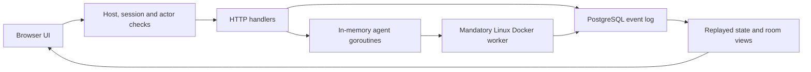

# Architecture

[Documentation index](README.md)

## Runtime shape

Agent CommonRoom is a Go HTTP server with a PostgreSQL event store and a browser UI written in plain JavaScript. It is one process, not a microservice deployment. There is no frontend build system or durable background queue.

The server runs from the repository root because it loads migrations and serves web assets from relative paths. Listening is restricted to numeric loopback addresses. Debian access uses an SSH tunnel rather than public HTTP hosting.

## Startup and request flow

Startup selects DATABASE_URL, falling back to private local configuration and then the development default. It connects to PostgreSQL, applies migrations/001.sql, prepares owner authentication, registers handlers, and starts HTTP serving.

API requests pass through host/origin and session checks, then actor/account and room checks. Individual handlers validate methods, mutation tokens, and payloads. Authorization is server-side; frontend controls are only presentation. The current owner/member policy is described in the API overview and security review.

## State and events

PostgreSQL `events` contains sequence, ID, kind, JSON payload, commit timestamp, previous hash, and hash. append serializes writers with a PostgreSQL advisory transaction lock. load replays the log into room.State, after which visibility helpers filter room and actor views.

This is event-sourced state reconstruction without cached projections or general pagination. Reading state repeatedly replays history; this is a known scaling concern. Some business operations append multiple separate records and are not atomic as a whole. Memory, member, task, and workflow updates use revision checks where implemented; there is no universal concurrency or lease model.

The trigger rejects normal UPDATE/DELETE/TRUNCATE operations. Hashes currently cover previous hash, event kind, and PostgreSQL's payload text. They omit some metadata and have no independent rollback anchor. A privileged database administrator can bypass protections; absolute immutability is not achieved.

## Agent execution

A mutex protects process-local active/cancel maps and parts of mutation handling. Accepted agent work starts a goroutine with a three-minute context deadline. Each participant is limited to one active turn by the in-memory map. Provider session identifiers are saved through participant.session events.

Managed adapters invoke executables through a mandatory Linux rootless-Docker worker; prompts travel over stdin. Other platforms and direct SSH endpoints are blocked. Codex uses a read-only sandbox. Claude disables tools, MCP servers, and slash commands for the conversational trial. History browsing uses a separate Codex app-server RPC process.

Jobs do not survive application restart as durable work items. Process-group cleanup, remote cancellation, global resource limits, workspace confinement, and policy-controlled tool execution are incomplete. Application monitoring alone cannot reliably contain an unrestricted process.

## Source responsibilities

| Area | Responsibility |
| --- | --- |
| cmd/server/main.go | Startup, HTTP registration, events, replay, state, and integrity handlers. |
| cmd/server/auth.go and owner_rsa.go | Sessions, request checks, first-owner setup, challenges, signatures, and key download. |
| cmd/server/members.go | Human invitations, actor projection, permissions, personal rooms, and visibility. |
| cmd/server/agents.go and history.go | CLI turns, SSH commands, session continuation, and saved-history RPC. |
| cmd/server/provider_auth.go | Local Claude status and macOS login launch. |
| cmd/server/rooms.go and workflows.go | Room filtering, profile guidance, and graph validation. |
| internal/room/model.go | Domain structs and adapter capability declarations. |
| migrations/001.sql | Event-store schema and mutation-rejection trigger. |
| web/app.js | Base UI, connection/profile forms, API calls, messages, and sign-in. |
| web/features.js | Room navigation, tasks/evidence, profile extensions, provider icons, and member UI. |
| web/workflows.js | Visual graph editor, connections, properties, validation, and undo/redo. |
| web/provider-auth.js | Claude authentication dialog and connection-screen action. |
| cmd/server/documentation.go and web/help*.js/html/css | Allowlisted documentation serving, safe reader, and contextual overlays. |
| web/index.html and style.css | Page entry, script order, styling, and layout. |

Frontend scripts share global state and wrap existing functions. Script order matters. This structure is an acknowledged maintenance concern, not a prescribed long-term modular architecture.

## Intended evolution

The backlog calls for stronger authorization, a controlled execution gateway with OS/process isolation, durable jobs and workflow state, typed adapter transports, stronger event integrity, independent immutable storage, explicit project permissions, structured evidence, and operational observability. These are planned improvements. Consult SECURITY_REVIEW.md before changing boundaries or claiming enforcement guarantees.

## Mandatory container isolation design contract

**Decision:** container isolation is a mandatory boundary for managed agent development, not an optional feature. The supported application will have no Security toggle, per-connection exemption, environment switch or automatic direct-execution fallback. If isolation cannot be established, new managed work must be blocked. Existing external conversations may be imported as context; importing a session does not make its externally launched process contained.

**Implementation status:** `codexAdapter.Run` and `claudeAdapter.Run` now call `isolatedAgentCommand`; direct model-turn launch commands have been removed. The initial worker provides private volumes, restricted provider egress, resource limits and bounded forced cleanup. It currently supports local Linux/rootless Docker only. Approved host directory mounts, remote workers and startup reconciliation remain open. Live Docker/provider verification was unavailable on the development machine, so SEC-04 is not declared closed. See [setup, policy and verification limits](container-isolation.md).

The intended trusted worker creates an isolated execution unit per agent/task. Rooms may approve multiple directories, each with explicit read/write access; agents receive separate working copies where appropriate. Workers enforce approved mounts, private session storage, restricted networking, minimal credentials, resource limits and confirmed shutdown. Agent containers receive no Docker socket, host home directory, SSH agent or application database/owner credentials. Remote agents need a worker enforcing the same contract on the remote machine; SSH transport alone is insufficient.

Human-authorized native-history import and provider sign-in are separate trusted administrative capabilities. They must not expose the whole host history/credential store to agents or become alternate model execution paths. Container configuration and the runtime remain part of the trusted security boundary; containers are not proof against every possible escape.

### Source-level bypass warning

Because the project is open source, you **CAN** fork it and circumvent the isolation contract by substituting direct local/SSH execution. **BUT this is a bad idea:** a compromised agent or malicious prompt can operate with the account's accessible files, provider credentials and network reach; unintended writes or external tools can affect the host; and stopping a launcher may leave descendants or remote work running. Room permissions and application monitoring cannot reliably contain a process given broader OS access. Removing isolation also invalidates the containment assumptions documented for the supported design.

That remains a source modification at the fork operator's risk, not a supported configuration. Do not represent a modified direct-execution adapter as isolated. Document this warning at adapter types, turn methods and command construction functions when introducing or changing execution paths.

See the [remote worker requirements](container-isolation.md#remote-worker-requirements) for keeping CommonRoom on one machine while running isolated agent containers on Debian. Remote-worker transport is planned; current direct SSH dispatch remains blocked.
