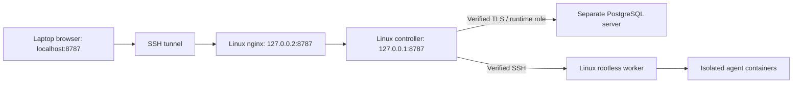

# Installation components and choices

[Quick start](quick-start.md) · [Step-by-step controller setup](installation.md)

Choose one option per component. Keep operating-system package changes separate
from application compilation, migrations and worker setup so failures are easy to
locate. Run commands as your normal user unless a specific system change needs
administrator access.

## Source checkout

```sh
git clone https://github.com/Daemon-Labs-Co/agent-commonroom.git
cd agent-commonroom
```

Use the actual checkout directory if you already have the source. Preserve local
changes when updating. Run the controller from the repository root because it
loads `web/`, `docs/` and `migrations/` from disk.

## Go through mise

Install mise using its [official platform instructions](https://mise.jdx.dev/installing-mise.html).
Then use an explicit tool version family matching `go.mod`:

```sh
mise install go@1.26
mise exec go@1.26 -- go version
mise exec go@1.26 -- bash scripts/setup.sh --build
```

Use the same `mise exec go@1.26 --` prefix for migration/start commands if Go is not
otherwise on PATH. `mise install` installs the tool without adding a project
configuration file. Follow the [mise Go guide](https://mise.jdx.dev/lang/go.html)
for shell activation and version selection. Patch updates should be reviewed and
tested; this example does not pin an immutable patch release.

## Go through the official installer or OS package manager

- **macOS:** use the official `.pkg`, or `brew install go` if Homebrew is already
  installed. Check `go version` against the `go.mod` requirement.
- **Linux:** use the official archive matching your architecture and follow the
  [Go installation instructions](https://go.dev/doc/install). An OS package is also
  usable if its version satisfies `go.mod`; older distribution packages may not.
- **Windows:** install WSL2 using [Microsoft's instructions](https://learn.microsoft.com/en-us/windows/wsl/install),
  then use the Linux Go setup inside WSL. A Windows Go installation does not supply
  the Linux toolchain used by these scripts.

Do not extract a new Go archive over an existing Go tree. Keep system toolchain
changes separate from the repository setup script. Verify `go version` before building.

## PostgreSQL: native or existing service

On macOS with existing Homebrew:

```sh
brew install postgresql@17
brew services start postgresql@17
export PATH="$(brew --prefix postgresql@17)/bin:$PATH"
```

On Debian/Ubuntu for a **new local installation**:

```sh
sudo apt update
sudo apt install postgresql postgresql-client
```

For an existing or separate server install only the required client package on
the controller host. Do not replace clusters or change other applications' roles.
PostgreSQL 17 has been exercised; validate the actual server version separately.
Follow [database security](database-security.md) for roles, authentication, migration
and grants. pgvector is not required for the current event store.

## PostgreSQL: optional local Docker service

Docker for the **database** is separate from the mandatory rootless agent worker.
Use this only for a new dedicated local development database, never to replace an
existing PostgreSQL server. The image tag below selects PostgreSQL 17; review and
pin an approved digest for a reproducible deployment.

Create a password file with your private editor at an absolute path **outside the
checkout**, restrict it to your user, then start the official image:

```sh
# Replace the example path with your real private file path.
chmod 600 /absolute/private/path/commonroom-postgres-password
docker run --name commonroom-postgres \
  --publish 127.0.0.1:5432:5432 \
  --mount type=volume,src=commonroom-postgres-data,dst=/var/lib/postgresql/data \
  --mount type=bind,src=/absolute/private/path/commonroom-postgres-password,dst=/run/secrets/postgres-password,readonly \
  --env POSTGRES_PASSWORD_FILE=/run/secrets/postgres-password \
  --detach postgres:17
```

Wait for readiness with `docker exec commonroom-postgres pg_isready -U postgres`.
Use `docker exec -it commonroom-postgres psql -U postgres` for the one-time DBA SQL;
create both application roles and the database, then follow migrations and grants.
The default `postgres` superuser is strictly administrative: never use it for
`DATABASE_URL`. Existing volumes retain their original database/password setup;
image environment settings do not reset it. Port/name conflicts should be resolved
explicitly, not by deleting an existing container or volume. Stop with
`docker stop commonroom-postgres`; preserve the named volume and private password.
See the [official image documentation](https://hub.docker.com/_/postgres) for lifecycle
and backup details. These commands are not run by automated tests.

## Compile, migrate, grant, serve

These are separate operations, deliberately:

```sh
go mod download
go build -o bin/commonroom ./cmd/server
# Or: bash scripts/setup.sh --build
```

Set the separate migration URL, then run `./bin/commonroom --migrate`. Apply the
runtime grants using the [administrator SQL](database-security.md#administrator-setup).
Remove migration credentials, set the restricted `DATABASE_URL`, then run
`./bin/commonroom`. Full environment examples are in [controller installation](installation.md).
On updates, stop active work and take protected backups first; retain the existing
migration owner and audit history. Do not start a second controller on the same data.

## Web server: Go directly

Go serves the API and browser assets together at `127.0.0.1:8787` by default.
No frontend package install, Node web server or bundling is required. Node and
Python are used by development checks. A standalone static Node server cannot
replace the authenticated API or safely serve the repository root, which contains
private runtime state. A Node reverse proxy is not a supported deployment recipe;
use Go directly or the documented nginx path.

## Web server: nginx

Use [the private nginx recipe](deployment/nginx-postgresql.md) to retain Host and
Origin, disable caching and listen only on loopback. Use the SSH tunnel from your
laptop. Public-domain HTTPS deployment still needs implementation work; nginx
alone does not make it supported.

## Hybrid deployment



The worker can live on the controller's Linux host under the approved worker
identity. The database uses separate runtime and migration identities. Provider
credentials belong in isolated connection storage, not the controller or tool
workspace. See [the hybrid walkthrough](quick-start.md#4-hybrid-linux-controller-nginx-docker-and-separate-postgresql).

## Check the result

Keep the controller running and use [installation diagnostics](installation-check.md)
from another terminal. Failed and incomplete checks identify the next setup stage
to fix without attempting repairs.
