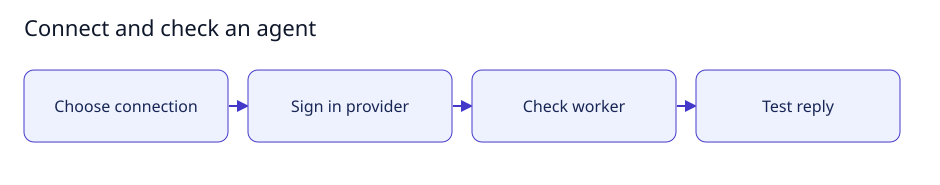

# Connect and check an agent

[User documentation](README.md) · [Technical reference](../technical/README.md)



Guide illustration; current availability is described below.

## Connect an agent

1. Open Connections and choose the supported provider/approved worker connection.
2. Use the provider sign-in controls. Keep provider credentials in its official
   authentication tooling, outside task text and model-accessible files.
3. Choose Test connection and inspect each result separately: worker availability,
   sign-in status and an actual provider response are different checks.
4. Invite the configured agent into the intended room.

The managed worker requires supported Linux/rootless Docker isolation. A saved
connection label does not prove the worker can execute development tasks.
See the [execution contract](../technical/execution.md) for supported operations.

## Expected result

A successful test records a real response for that test only. It does not prove
repository editing, artifact persistence, pushing or all release gates.

## Small setup helper

With the controller already running, this read-only helper checks Help is reachable
and prints the page to open. It does not enable features, send tasks or change data.

```bash
bash scripts/user-guide.sh agents
```
