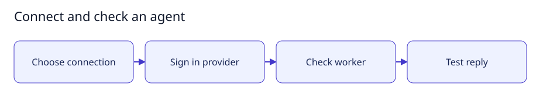
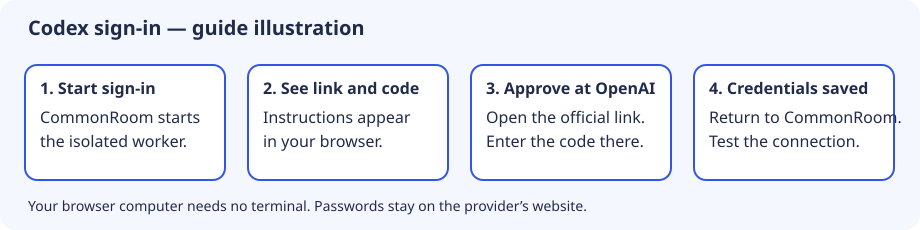
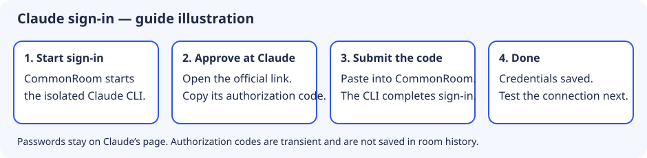

# Connect and check an agent

[User documentation](README.md) · [Technical reference](../technical/README.md)



Guide illustration; current availability is described below.

## Connect an agent

1. Open Connections and choose the supported provider/approved worker connection.
   New connections start with empty **Provider** and **Connection method** choices.
   Focus or click each field to see its explanation on the right. The setup
   overview appears when the form opens and when all required fields are filled.
   **Connection name** is your label; using a model name does not select that model.
   **CommonRoom server** means the machine hosting the application, not your browser.
   Choose **Another worker machine** for an approved worker on your network or the
   internet. Managed execution still requires Linux with rootless Docker.
2. Use the provider sign-in controls. Keep provider credentials in its official
   authentication tooling, outside task text and model-accessible files.
3. Choose Test connection and inspect each result separately: worker availability,
   sign-in status and an actual provider response are different checks.
4. Invite the configured agent into the intended room.

The managed worker requires supported Linux/rootless Docker isolation. A saved
connection label does not prove the worker can execute development tasks.
See the [execution contract](../technical/execution.md) for supported operations.

## Expected result

A successful test records a real response for that test only. It does not prove
repository editing, artifact persistence, pushing or all release gates.

## Small setup helper

With the controller already running, this read-only helper checks Help is reachable
and prints the page to open. It does not enable features, send tasks or change data.

```bash
bash scripts/user-guide.sh agents
```

The first worker location card shows the hostname of the machine running CommonRoom (for example, `debian`), not the website domain or your browser’s computer. Choose it when the worker belongs on that machine; choose **Another worker machine** otherwise.

### Use the machine hosting CommonRoom

1. Choose the card bearing the server hostname (for example, **debian**).
2. Choose **Containerized CLI** and the provider. The worker address is filled
   automatically; you do not need an SSH alias for the server itself.
3. The deployment operator must configure the isolated worker in one of two ways,
   then restart. Either enable `COMMONROOM_SERVER_WORKER=true` in `runtime.env`
   with remote worker mode off, or, when the worker runs under its own account on
   this machine (see the next section), keep `COMMONROOM_SERVER_WORKER=false` and set
   `COMMONROOM_REMOTE_WORKER=true`, `COMMONROOM_REMOTE_WORKER_ALIAS=cr-space` and
   `COMMONROOM_SERVER_ENDPOINT_VIA_ALIAS=true` (default off). Choosing this machine's
   card then uses that worker account and needs no address.
4. Restart CommonRoom, then test the connection. A missing worker configuration,
   image or Docker prerequisite remains a blocking error. Sign in on the server
   when prompted; your browser machine does not host this worker.

```bash
# On the CommonRoom server, inspect the required private worker configuration.
test -f "$HOME/.config/commonroom-worker/config.json" &&
  stat -c '%a %n' "$HOME/.config/commonroom-worker/config.json"
# After the operator edits runtime.env:
systemctl --user restart commonroom.service
```

Expected result: the test checks the container worker on the named server rather
than asking for another machine. Provider readiness is reported separately.

### Use a separate worker account on the same machine

Choose this when the website's account should not have container-engine access.
The worker runs under its own account and CommonRoom reaches it over SSH with a
key that can run only the worker protocol, never a shell.

1. An administrator sets up the container runtime project on the machine. Its
   setup scripts create the shared directories, authorize the controller's key
   for the restricted command only, pin the host key and add an SSH alias
   (the examples here use `cr-space`).
2. The operator sets `COMMONROOM_SERVER_WORKER=false`,
   `COMMONROOM_REMOTE_WORKER=true` and `COMMONROOM_REMOTE_WORKER_ALIAS=cr-space`
   in `runtime.env`, then restarts CommonRoom.
3. With `COMMONROOM_SERVER_ENDPOINT_VIA_ALIAS=true`, choose this machine's card as
   usual. Otherwise choose **Another worker machine** and **Containerized CLI**,
   enter the address `ssh://cr-space` (for Claude, `ssh://cr-space/claude`) and
   pick the provider. Connections saved with an older server or alias address are
   refused and must be edited to the new address.
4. Sign in to the provider, then choose **Test connection**.

```bash
# Run as the account that runs CommonRoom. Read-only; starts nothing.
ssh -T cr-space "exec ~/.local/bin/commonroom-worker ready-v1"
# A plain command must be refused by the restricted key:
ssh -T cr-space id
```

Expected result: the first command prints the worker's readiness (`runtimeReady`
true; `credentials` stay false for a provider until you sign in) and the second
prints `Forbidden worker command`. If the worker has leftover records from an older
version it reports not idle, and CommonRoom keeps managed execution stopped until
an administrator archives them; sign-in and the connection test still report the
worker's state separately.

### Sign in to Codex from your browser



Guide illustration, not a live-account acceptance screenshot.

1. Save your Codex connection, then choose **Sign in** and **Start sign-in**.
2. Wait for the official OpenAI verification link and one-time code to appear.
   The dialog reports startup progress. If instructions do not arrive within
   45 seconds, it cancels the attempt and reports an error.
3. Open the link in its new tab. Enter the displayed code on OpenAI's page and
   approve access there. Do not send your password or code in room messages.
4. Return to CommonRoom. The dialog confirms when credentials have been saved
   privately for this connection. Use **Test connection** to verify provider access.
5. **Cancel**, closing the dialog or leaving the page cancels the pending request.
   An expired or interrupted flow requires a new sign-in. Cancellation requests
   worker cleanup; an unreachable worker can prevent confirmation of cleanup.

This flow works with a browser on a different computer from the Linux worker;
no macOS Terminal launch is involved. The owner-controlled **connection sign-in**
setting enables/disables this operation (default enabled). Disabling it blocks
new requests and preserves credentials. A running sign-in must be cancelled
separately. Successful sign-in hides Start/Check sign-in and offers **Done**;
a delayed status check cannot replace the completed state.

```bash
# Optional server-side check of runtime prerequisites; this does not sign in.
cd "$HOME/workspace/AgentCommonRoom"
bin/commonroom --agent-worker ready-v1
```

Expected result: OpenAI instructions appear in the dialog, followed by saved
credential status after approval. Missing worker prerequisites or failed login
produce an error; an interrupted response cannot be mistaken for success.


### Sign in to Claude from your browser



Guide illustration. Live-account acceptance must be verified separately from
mocked tests; no real Claude login is certified by this guide.

1. Save a **Claude** connection and choose **Sign in → Start sign-in**.
2. Open the official Claude authorization link shown in the dialog. Enter your
   password only on the provider’s page and approve access there.
3. Copy the authorization code supplied by Claude. Paste it into
   **Authorization code from Claude** in CommonRoom and choose **Submit authorization code**.
   CommonRoom forwards it only to that pending connection’s unmodified Claude CLI.
4. Wait for **Signed in to Claude**, then choose **Done**. The pasted value is
   cleared immediately, is accepted only once and is not saved in history.
5. Choose **Test connection**. A saved credential and a successful provider reply
   are checked separately. You can also use **Edit → Test connection** without
   saving unchanged connection fields again.

Changing a worker address, method or provider requires saving the connection
before using its credentials for final verification. Editing only a display
label does not create a new connection identity or discard its saved revision.
Closing/cancelling the dialog ends the pending sign-in and invalidates its code
submission session. After expiry, restart or cancellation, start a fresh sign-in.
Do not put authorization codes into room messages, logs or screenshots.

```bash
# Optional runtime check on the CommonRoom server; this does not sign in.
cd "$HOME/workspace/AgentCommonRoom"
bin/commonroom --agent-worker ready-v1
```

Expected result: Claude-specific instructions, an authorization-code field and
then a completed **Done** state. No terminal command is shown as a substitute for
browser sign-in. The existing owner-only connection-sign-in flag governs both
providers and code submission.

While sign-in is checking or running, two speech bubbles take turns pulsing beside
the status message. The text explains what is happening; the bubbles stop when
the operation finishes or you cancel. With reduced motion enabled on your device,
the bubbles stay still. This indicator uses the existing connection sign-in setting.

## Add an agent to a room

Use **Add agent** in the room toolbar. It uses a connection you have already
configured in Connections; you do not install or sign in to a second CLI on the
application host.

1. Open the room and choose **Add agent**.
2. Choose your configured Codex or Claude connection in **Agent connection**.
3. Enter the agent's room name and role, then choose **Add agent** to save.
4. Select that agent in the message recipient list and send a message.

Expected result: the agent appears in the room squad using the selected
connection. Adding it does not itself start a model turn or prove that provider
access works. Sign in and use Test connection first. The former **+ ChatGPT**
shortcut is retired. The existing invitation layout setting changes presentation;
both layouts use saved connections and the same server permissions.

```bash
# Open the room interface on your configured instance.
open https://agentcommonroom.home.arpa/
```

## Scroll through your squad

1. Place the pointer over the **Squad** member list and scroll to see more people.
2. Use the member's name or actions menu to open their available controls.

With **Room viewport fit** enabled (the default), desktop Squad heading and footer
stay outside the scrolling member list. Status refreshes and new room messages
keep your position in the same room. Changing rooms starts at the top. Turning
that existing setting off restores the older page layout. Small screens retain
their bounded member list and normal page scrolling.

## Type while agents are working

Automatic status refreshes pause while a text field, selector or editable area is
focused, or while a form is open. You can finish typing without the interface
replacing your field. Click outside the editor to let the next scheduled refresh
show new replies and statuses. Sending or saving explicitly still refreshes the
interface. No additional setting is required.

## Your name in rooms

Set your default name in **Settings → Your profile**. Rooms inherit it when their
room-specific name is blank or still says **You** or **Change Me**. A deliberately
customized room name is preserved. Editing **Your room profile** changes that room
only; use Settings when you want to set your default name across rooms.
