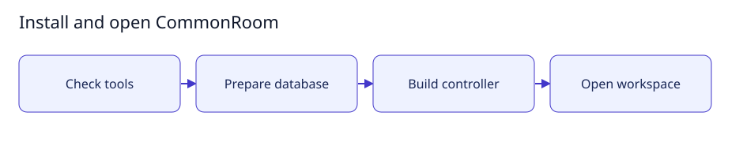

# Frequently asked questions

[User documentation](README.md) · [Installation guide](getting-started.md)



Guide illustration of application setup; configuration is read during startup,
separately from building the application.

## Is runtime.env compiled at runtime, or does it always exist?

`runtime.env` is a regular configuration file on disk. It is **not compiled** and
is **not generated each time CommonRoom runs**. You create it during deployment;
it remains there until you edit, move or remove it.

With the supplied systemd user service, systemd reads that file when starting
CommonRoom and passes its settings to the application as environment variables.
The application does not load the file directly. The filename is a deployment
convention: `.env` would work too if the service's `EnvironmentFile` pointed to it.
Merely placing a `.env` beside the application does not make the app read it.

To change a setting:

1. Find the file referenced by `EnvironmentFile` in your CommonRoom service.
   The versioned service template uses `~/.config/commonroom/runtime.env`; an
   existing deployment may point somewhere else.
2. Edit that private file and save it. Keep credentials out of Git, screenshots
   and messages, and keep the file readable only by its owner (`0600`).
3. Restart the user service:

   ```bash
   systemctl --user restart commonroom.service
   ```

## Expected result

CommonRoom starts with the updated environment settings.
You do not need to rebuild the application. Changing the file alone does not
change the environment of an already running process. The service needs the file
to remain available for future starts.

See [deployment templates](../../deployment/README.md) for configuration and service
examples, and [settings](settings.md) for controls saved through the browser.

## What does “Emergency agent stop active” mean?

> Emergency agent stop active · New turns are blocked. Cancellation has been
> requested; remote termination is not confirmed.


Guide illustration: requesting cancellation and confirming shutdown are separate
steps.

CommonRoom has blocked new agent turns for the application or the affected room
and requested cancellation of managed work. **The banner is not confirmation that
every worker container, remote process or already launched external tool stopped.**
It also does not prove that something is still running: shutdown is unverified.

To proceed:

1. Inspect the affected jobs and worker diagnostics. Wait for active controller
   turns to finish cancellation and confirm the worker is idle.
2. Once it is safe, the owner can choose **Resume all agents**, or **Resume room
   agents** for a room-only stop, and confirm **Resume dispatch**. An application
   stop must be cleared before a room can resume; resuming the application does
   not clear a separate room stop.
3. If resume reports **Worker shutdown is unverified**, keep execution stopped
   and resolve the worker connection or shutdown verification first. A disabled
   or unconfigured worker transport cannot confirm that the worker is idle.

Resume also requires a freshly verified history chain and no integrity stop.
If the confirmation dialog stays open, read the error shown inside it: a rejected
resume leaves dispatch stopped and the button available for a later retry. After
the server accepts resume, the dialog closes. If the subsequent status refresh
fails, CommonRoom reports that separately; refresh the page to confirm the state.
Do not delete stop markers, disable isolation or edit history to dismiss the
banner. Restarting the server does not clear a persisted stop. Resuming permits
new requests; it does not automatically restart cancelled work.

See [stop, diagnose and recover work](recovery.md) for the related controls.

## Why does sending to Everyone say “Room agent concurrency limit reached”?

Sending to **Everyone** requests a reply from every eligible agent in the room.
CommonRoom currently permits **four simultaneous agent replies per room**, and
**eight across the application**. Active turns, including connection verification
jobs assigned to the room, consume available slots.

If the requested replies exceed the available slots, the entire request is
rejected before dispatch. The remaining replies are **not queued**. The error is
about the number of replies requested, not the wording of your message or the
number of agents you may add to the room.

1. Select one agent in the message recipient list and send your message.
2. Wait for its reply to finish, then select the next agent.
3. Retry **Everyone** only when the whole eligible group fits the available slots.

Expected result: requests within the available limit can proceed. If more than
four agents are eligible, waiting alone will not make an **Everyone** request fit;
message agents individually. There is currently no UI setting to raise this limit.

## Small setup helper

With the controller already running at the default loopback address, this
read-only helper checks Help is reachable and prints the FAQ address. It does not
read credentials, edit configuration or restart the service.

```bash
bash scripts/user-guide.sh faq
```
