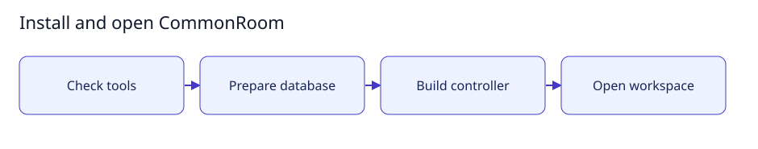

# Install and open CommonRoom

[User documentation](README.md) · [Technical reference](../technical/README.md)



Guide illustration; current availability is described below.

## Before you start

Use Go1.26+, PostgreSQL and a current browser. Development checks also use Node.js
and Python3.8+. Run commands from the repository root. Keep database URLs and
provider credentials outside documents and screenshots.

## Set up

1. Run `bash scripts/setup.sh --check` to check build prerequisites.
2. Prepare separate migration and runtime database roles using the
   [database contract](../technical/archive/database-security.md).
3. Set `MIGRATION_DATABASE_URL` privately and run `bash scripts/setup.sh --migrate`.
4. In the runtime terminal, set `DATABASE_URL` to the restricted runtime role and
   run `bash scripts/setup.sh --start`.
5. Open `http://127.0.0.1:8787` and complete owner-key setup. Save the key privately.

## Expected result

You can sign in and open the workspace. A running controller does not establish
that an agent worker, code execution, storage quotas or file delivery is ready.
For platform-specific packages, use the [retained installation procedure](../technical/archive/installation.md).

## Small setup helper

With the controller already running, this read-only helper checks Help is reachable
and prints the page to open. It does not enable features, send tasks or change data.

```bash
bash scripts/user-guide.sh getting-started
```
