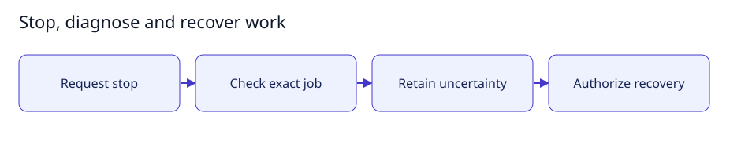

# Stop, diagnose and recover work

[User documentation](README.md) · [Technical reference](../technical/README.md)



Guide illustration; current availability is described below.

## Stop and diagnose

1. Request Stop and read the resulting status. Requested cancellation is not
   confirmation that a remote helper has disappeared.
2. Open job diagnostics and retain the exact job identity and failure details.
3. Use explicit owner reconciliation only after inspecting the worker evidence.
4. Preserve journals, artifacts and capacity when cleanup is uncertain.

Known-ID cleanup cannot discover/adopt containers by name. Unknown creation
outcomes need independent investigation. Never delete a stop marker or journal
merely to make a retry available. Credential-recovery controls require their own
current authorization.

## Expected result

Verified cleanup records absence; otherwise work remains visibly uncertain.
Recovery does not automatically retry the task, refund storage, publish code or
accept a deliverable. See [recovery behavior](../technical/recovery.md).

## Small setup helper

With the controller already running, this read-only helper checks Help is reachable
and prints the page to open. It does not enable features, send tasks or change data.

```bash
bash scripts/user-guide.sh recovery
```
