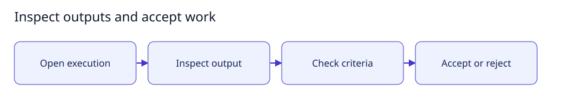

# Inspect outputs and accept work

[User documentation](README.md) · [Technical reference](../technical/README.md)



Guide illustration; current availability is described below.

## Review a result

1. Open the task's execution history and select the current work attempt.
2. Inspect returned outputs and the exact definition/input versions used.
3. Where criterion review is enabled, record each criterion's decision against
   those outputs. An agent review is advisory; you retain acceptance authority.
4. Accept verified work or request changes with a reason.

Required file/patch delivery and automatic repository publishing are still awaiting
production integration. There is no working push button to document yet. An
internal manifest or synthetic test receipt is not a downloadable user artifact.
The agreed product scope includes repository pushing as a basic capability.

## Expected result

Acceptance is tied to the current execution and inputs. Stale results cannot be
reused as approval for changed work. See [artifact behavior](../technical/artifacts.md)
and [publishing status](../technical/publishing.md).

## Small setup helper

With the controller already running, this read-only helper checks Help is reachable
and prints the page to open. It does not enable features, send tasks or change data.

```bash
bash scripts/user-guide.sh results
```
