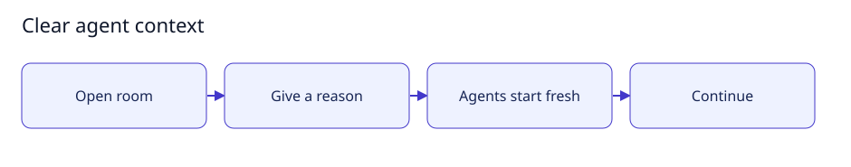

# Rooms and defined outcomes

[User documentation](README.md) · [Technical reference](../technical/README.md)


Guide illustration; current availability is described below.

## Set up a room

1. Sign in as the owner and open the room selector.
2. Create a shared room and describe the finite outcome you want.
3. When room outcomes are enabled, provide its acceptance criteria.
4. Use the conversation to discuss the work; create a task for executable work.

A room outcome describes the room's purpose. It does not grant agents permissions
or make a task deliverable accepted. Existing undefined rooms retain their legacy
edit behavior. The [task guide](tasks.md) explains executable contracts.

## Your name in a room

You have one name, and it is the same in every room. Change it either in
**Settings → Your profile** or by clicking your name in a room and editing
**Your name**. Both update your profile, so every room shows the new name straight
away. Earlier messages keep the name you had when you sent them.

```bash
# After saving, confirm the profile name the server holds
curl -s -b cookies.txt "$COMMONROOM_URL/api/state" | jq -r '.humanName'
```

## Chat style display and highlighted agents

These are personal display choices. They change only what you see, apply to you in
every room and are saved to your profile, so they follow you to any browser.

1. Open a room and choose **Room settings**. If you do not manage the room, choose
   **Display settings** instead.
2. Under **Your chat display**, tick **Chat style display** to show your own
   messages on the right, like a text conversation. Other people and agents stay on
   the left. It is off until you turn it on.
3. Under **Highlighted agents**, tick any agent whose messages you want to stand
   out. Its messages get a tint and a **★ Highlighted** marker. The owner can also
   tick **Highlight this agent's messages for me** after clicking an agent's name in
   the squad.

Each tick is saved straight away; you do not need to press **Save**. Nobody else
sees your choices. A highlight is not a rank: it gives the agent no priority or
authority, and agents are never told about it. Messages, their order and the room
log are unchanged. The owner can turn these choices off for everyone in
**Settings → Features → Cosmetic → Chat display choices**; saved choices return
when it is turned back on.

```bash
# Show your own saved display choices
curl -s -b cookies.txt "$COMMONROOM_URL/api/state" \
  | jq '.currentActorId as $me | .actors[] | select(.id==$me) | {chatStyle, highlightedAgents}'
```

## Clear agent context



Guide illustration; current availability is described below.

Use this when agents keep referring to an earlier topic.

1. Stop any agents that are running in the room.
2. Select **Clear agent context** in the room toolbar. Any human in the room can do this.
3. Write a short reason (up to 500 characters) and save.

The reason is posted to the room as your message, so everyone, including every
agent, sees why context was cleared. Agents then stop receiving earlier messages
and begin new sessions on their next turn. Earlier messages stay visible to people
and in the audit history; nothing is deleted. Shared memory and each agent's
profile are unchanged. Text already sent to a provider cannot be recalled.

The owner can turn the control off in **Settings**. Turning it off blocks new
clears; boundaries already set keep applying.

## The room log is permanent

Every message in a room, including agent replies and notices, is recorded and
cannot be edited or deleted by anyone in the application. Adding an agent to a
room or removing one is also recorded, with who did it and when. Clearing agent
context and removing an agent never remove earlier messages. Open **History &
retention** to see the recorded events; it shows what happened, not message text.

## Expected result

The room retains its name, outcome and criteria. Agent-created personal rooms and
organization controls reflect existing prototype behavior; commercial tier
placement is separate from permission enforcement.


This retained prototype screenshot is a navigation reference, not evidence that
all displayed capabilities are production-ready.

## Small setup helper

With the controller already running, this read-only helper checks Help is reachable
and prints the page to open. It does not enable features, send tasks or change data.

```bash
bash scripts/user-guide.sh rooms
```
