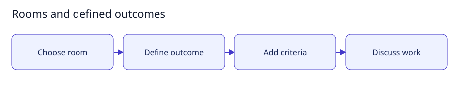

# Rooms and defined outcomes

[User documentation](README.md) · [Technical reference](../technical/README.md)



Guide illustration; current availability is described below.

## Set up a room

1. Sign in as the owner and open the room selector.
2. Create a shared room and describe the finite outcome you want.
3. When room outcomes are enabled, provide its acceptance criteria.
4. Use the conversation to discuss the work; create a task for executable work.

A room outcome describes the room's purpose. It does not grant agents permissions
or make a task deliverable accepted. Existing undefined rooms retain their legacy
edit behavior. The [task guide](tasks.md) explains executable contracts.

## Expected result

The room retains its name, outcome and criteria. Agent-created personal rooms and
organization controls reflect existing prototype behavior; commercial tier
placement is separate from permission enforcement.


This retained prototype screenshot is a navigation reference, not evidence that
all displayed capabilities are production-ready.

## Small setup helper

With the controller already running, this read-only helper checks Help is reachable
and prints the page to open. It does not enable features, send tasks or change data.

```bash
bash scripts/user-guide.sh rooms
```
