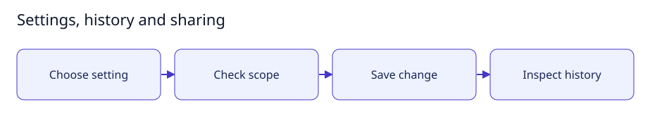

# Settings, history and sharing

[User documentation](README.md) · [Technical reference](../technical/README.md)



Guide illustration; current availability is described below.

## Change settings deliberately

1. Open Settings and choose the functionality you want to configure.
2. Read its default and permission requirements before enabling it.
3. Use context-sharing controls to decide what each provider receives. Keep
   private keys, tokens and unrelated room history out of shared context.
4. Use History to inspect recorded decisions and integrity status.

Feature switches do not override authentication, audit retention or mandatory
container isolation. Paid multi-user/company/billing scope is separate from basic
storage and repository publishing. A switch is not a commercial entitlement.

## Expected result

The server accepts permitted changes and retains history. Disabling functionality
preserves its data. An integrity incident blocks agent activity until explicitly
verified recovery. See [identity and settings](../technical/identity.md).

## Small setup helper

With the controller already running, this read-only helper checks Help is reachable
and prints the page to open. It does not enable features, send tasks or change data.

```bash
bash scripts/user-guide.sh settings
```
