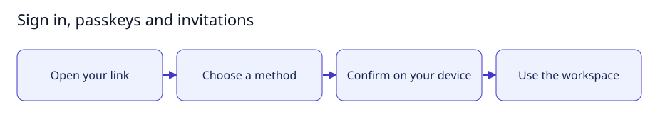

# Sign in, passkeys and invitations

[User documentation](README.md) · [Technical reference](../technical/README.md)



Guide illustration; current availability is described below.

A workspace can offer several ways to sign in. Which ones you see depends on how it is
run: hosted workspaces offer passkeys and invitation links from the start; a workspace
you run yourself offers them only after its owner turns them on (see
[Turn methods on or off](#turn-methods-on-or-off)). The owner key file always works for
the owner and is the way to recover access.

## Create your own workspace

Some installations let anyone create a workspace. If yours does, open its main address
(for example `https://rooms.example.com`):

1. Enter a workspace name. The address fills in from it; change it if you like (2-63
   lowercase letters, digits or hyphens).
2. Enter the sign-up code if the page asks for one.
3. Choose **Create workspace**, then open the setup link shown. It works for the first
   owner only, so open it on the device you will use and keep it private.
4. Create your passkey on the next screen. You can then invite others (see below).

If the address is taken you are asked to choose another. If you see "try again later",
sign-up is limited to protect the service; wait and retry. The page does not exist when
the operator has not turned sign-up on.

## Accept an invitation

1. Open the invitation link the owner sent you. It looks like
   `https://your-workspace.example.com/#invite=…` and works once.
2. Enter your name.
3. Choose **Create a passkey** and confirm with your device (fingerprint, face, screen
   lock or security key), or choose **Continue with** your organization's single
   sign-on if it is shown.

If the page says the invitation is not valid, it has expired, was already used or was
withdrawn. Ask the owner for a new one. Anyone who has an unused link can accept it, so
keep it private.

## Sign in again

On the sign-in page choose **Passkey** (your device offers the passkeys it holds for
this workspace) or your organization's single sign-on button. If your identity is not
linked to an account here you are told so and nothing is created. The owner can also use
their key file as before.

## Add or remove ways to sign in

1. Open **Settings → Profile → Your sign-in methods**.
2. Choose **Add a passkey** and confirm on your device, naming it so you can recognise it
   (for example "Work laptop"), or choose **Link** to connect single sign-on.
3. To remove a passkey choose **Remove**. You cannot remove your last way to sign in.

## Invite someone (owner)

1. Open **Settings → Company → Sign-in options and invitations**.
2. Choose a role, the shared rooms they may enter and how long the link stays valid
   (1, 3 or 7 days), then **Create invitation link**.
3. Copy the link and send it privately. Unused links are listed there and can be
   **Revoked**; used and expired links disappear.

Unused invitations count towards your workspace's member limit. Roles and room access
are set when you invite and can be changed later in **Company members**. People you invite
get their own personal room and see only the rooms you assigned.

## Turn methods on or off

In the same owner card, tick or untick **Passkeys**, **Single sign-on** and **Invitation
links**. Turning one off hides it and the server refuses it; saved passkeys and links are
kept for when you turn it back on. Single sign-on is available only when the operator of
the installation has set up an identity provider.

## Expected result

You can sign in with the method you chose, the history records how accounts were created
and which method was used, and nobody can see another person's passkeys or links.

```bash
# Open this guide from your running controller (read-only)
bash scripts/user-guide.sh sign-in

# Check which sign-in methods this workspace offers (no sign-in needed; changes nothing)
curl -s "$COMMONROOM_URL/api/auth/methods"
```
