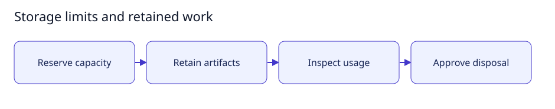

# Storage limits and retained work

[User documentation](README.md) · [Technical reference](../technical/README.md)



Guide illustration; current availability is described below.

## Understand storage

Basic storage accounting is core functionality. Capacity reservations, actual
physical enforcement and filesystem free space are different measurements.
Retained or uncertain work remains charged until approved disposal is verified.

## Check deployment storage

Use the operator-provisioned absolute private policy; never invent root identities
from a first observation. Run `./bin/commonroom --check-worker-storage "$POLICY"`
after setting `POLICY` privately. The check reads existing quota evidence; it does
not enable quotas, allocate storage or authorize execution.

The implemented native observer requires XFS project quotas on Linuxamd64. The
inspected Jerry Docker storage is ext4, so that prerequisite remains unresolved.
Existing disks back the root filesystem and were not selected for reformatting.

## Expected result

The preflight either reports bounded point-in-time observations or refuses. Neither
outcome alone proves complete inventory or permission to launch work. Follow the
[storage contract](../technical/storage.md); configuration changes need approval.

## Small setup helper

With the controller already running, this read-only helper checks Help is reachable
and prints the page to open. It does not enable features, send tasks or change data.

```bash
bash scripts/user-guide.sh storage
```
