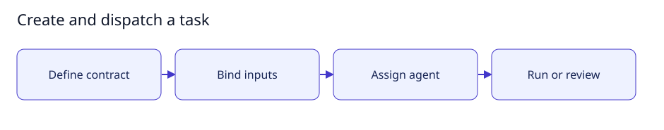

# Create and dispatch a task

[User documentation](README.md) · [Technical reference](../technical/README.md)



Guide illustration; current availability is described below.

## Define work

1. Enable Task definitions in Settings when using structured tasks.
2. Create a task with seven parts: task, expected input, process, desired output,
   acceptance criteria, execution constraints and failure contract.
3. Choose the assignee; choose a separate reviewer where the workflow requires one.
4. Supply actual input values and source-version labels before dispatch.
5. Run work, then review its recorded execution and returned outputs.

A deliverable is a returned object satisfying its contract, not an agent's claim
that work is done. Definition revisions and execution records are separate.
Required file/bundle outputs currently refuse dispatch until verified storage is
connected. Do not change them to values merely to conceal a missing file result.

## Expected result

A permitted value task produces an execution record and validated returned values.
Permission failures, missing inputs and unavailable file delivery remain visible.
See [task contracts](../technical/tasks.md) for limits and state changes.

## Small setup helper

With the controller already running, this read-only helper checks Help is reachable
and prints the page to open. It does not enable features, send tasks or change data.

```bash
bash scripts/user-guide.sh tasks
```
