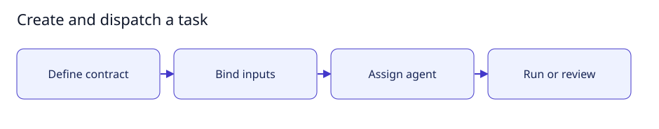

# Create and dispatch a task

[User documentation](README.md) · [Technical reference](../technical/README.md)



Guide illustration; current availability is described below.

## Define work

1. Enable Task definitions in Settings when using structured tasks.
2. Create a task with seven parts: task, expected input, process, desired output,
   acceptance criteria, execution constraints and failure contract.
3. Choose the assignee; choose a separate reviewer where the workflow requires one.
4. Supply actual input values and source-version labels before dispatch.
5. Run work, then review its recorded execution and returned outputs.

A deliverable is a returned object satisfying its contract, not an agent's claim
that work is done. Definition revisions and execution records are separate.
Required file/bundle outputs currently refuse dispatch until verified storage is
connected. Do not change them to values merely to conceal a missing file result.

## Let agents suggest tasks

Off by default. An owner turns it on under **Settings → Feature flags → Agents ·
Task suggestions**. Capturing also needs **Task proposals** to be on.

1. In a room, click **Suggest tasks**. The room's governing agent (or, if none is
   appointed, the first available agent) reads the recent conversation and replies
   with lines like `[PROPOSE TASK] title :: acceptance criteria :: assignee`.
2. Suggested tasks appear above the conversation. Any agent's reply containing such
   lines is listed the same way, and a discussion that ends with every agent
   agreeing asks for suggestions automatically.
3. The owner clicks **Capture** to turn a suggestion into a proposal, then reviews
   and approves it under **Tasks** as usual. **Dismiss** hides it.

When a suggestion names an agent in the room and has acceptance criteria, the owner
also sees **Approve and send to name**. One click captures, approves, assigns and
sends the task, making the same four requests you would make by hand.

A suggestion creates nothing by itself. Only a human's capture and approval create a
task.

## Expected result

A permitted value task produces an execution record and validated returned values.
Permission failures, missing inputs and unavailable file delivery remain visible.
See [task contracts](../technical/tasks.md) for limits and state changes.

## Small setup helper

With the controller already running, this read-only helper checks Help is reachable
and prints the page to open. It does not enable features, send tasks or change data.

```bash
bash scripts/user-guide.sh tasks
```
