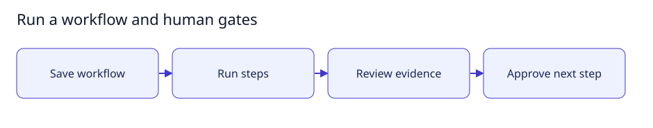

# Run a workflow and human gates

[User documentation](README.md) · [Technical reference](../technical/README.md)



Guide illustration; current availability is described below.

## Run a supported workflow

1. Open Workflows, choose or create a graph and save its revision.
2. Assign supported agent/review steps and include explicit human approval gates.
3. Enable Workflow execution when required, then run the saved clean graph.
4. Inspect each result. At a human gate, record a decision and rationale.
5. Request changes or stop when evidence is missing; do not treat a model reply
   as human approval.

The current runner supports bounded sequential execution. The editor displaying a
node type is not a guarantee that a parallel/distributed execution engine exists.

## Expected result

The run records step transitions and pauses for human decisions. Unsaved changes
cannot silently alter a running revision. See [execution behavior](../technical/execution.md).

## Small setup helper

With the controller already running, this read-only helper checks Help is reachable
and prints the page to open. It does not enable features, send tasks or change data.

```bash
bash scripts/user-guide.sh workflows
```
